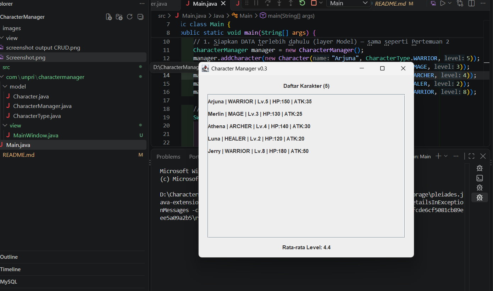

# Character Manager — TP3 (Java Visual SIH-6406)

Character Manager adalah aplikasi Java sederhana untuk membuat dan mengelola karakter game menggunakan konsep pemrograman berorientasi objek. Aplikasi ini memodelkan nama, jenis, level, HP, attack, dan mana karakter, serta menyediakan pemeriksaan status hidup melalui method `isAlive()`.

# Hasil Program terminal

Berikut screenshot hasil eksekusi aplikasi:


# Fitur Analitik Rancangan Sendiri -TP5

Fitur tambahan yang dibuat adalah `renameCharacter(oldName, newName)` pada
`CharacterManager`. Method ini mengganti nama karakter yang sudah terdaftar,
tetapi hanya jika karakter dengan nama lama ditemukan dan nama baru tidak
kosong serta belum digunakan oleh karakter lain. Jika validasi gagal, method
mengembalikan `false` dan data karakter tidak diubah; jika berhasil,
mengembalikan `true`.

Fitur ini berguna untuk memperbarui nama karakter tanpa menghapus lalu membuat
karakter baru, sehingga tipe, level, dan atribut lainnya tetap dipertahankan.
Encapsulation tetap terjaga karena method bekerja langsung pada koleksi internal
`CharacterManager` tanpa mengembalikan atau mengekspos `ArrayList` tersebut.
Pengujiannya di `Main.java` menunjukkan bahwa penggantian nama Merlin menjadi
Arjuna ditolak karena nama Arjuna sudah dipakai, sedangkan penggantian Merlin
menjadi Gandalf berhasil.

# MainWindow, Data Dinamis & Analisis MVC -TP8

# Screenshot MainWindow

Berikut tampilan MainWindow dengan lima karakter. Rata-rata level yang
ditampilkan adalah 4,4.



# Aliran Data dan MVC

`Main.java` membuat data karakter melalui `CharacterManager`, lalu meminta
salinan daftar karakter dan rata-rata level dari model. Kedua nilai tersebut
dikirim ke `MainWindow` saat jendela dibuat. `MainWindow` menampilkan setiap
karakter melalui loop dan menampilkan rata-rata yang sudah dihitung model.
Dengan demikian, model mengelola data dan perhitungan, sedangkan view bertugas
menampilkan data; GUI dijalankan di Event Dispatch Thread menggunakan
`SwingUtilities.invokeLater()`.

# Karakter Tambahan

- Luna — `HEALER`, level 2: dipilih sebagai karakter pendukung dengan level
  lebih rendah agar variasi level terlihat dan memengaruhi rata-rata.
- Jerry — `WARRIOR`, level 8: dipilih sebagai karakter petarung level
  tinggi untuk menambah variasi level dan tipe karakter.


# Struktur Folder Project

```text
CharacterManager/
├── README.md
├── images/
│   ├── Screenshot.png
│   ├── MainWindow-TP8.png
│   └── screenshot output CRUD.png
└── src/
    ├── Main.java
    └── com/
        └── unpri/
            └── charactermanager/
                ├── model/
                │   ├── Character.java
                │   ├── CharacterManager.java
                │   └── CharacterType.java
                └── view/
                    └── MainWindow.java
```
# Identitas Mahasiswa 

- Nama Lengkap:JERRY LIM
- NIM:253303621237
- Google Docs — TP3 Bagian D:[Buka dokumen Google Docs](https://docs.google.com/document/d/1QCCENsT26y548l06515b_NNMhOVXbDBsuPcFhBB3kfo/edit?usp=sharing)

- Google Docs — TP5 Bagian D:[Buka dokumen Google Docs](https://docs.google.com/document/d/1U4AAVVxghHRqwvg9p-WrIZhaKMxz98BZm47wv41bs3c/edit?usp=sharing)

- Google Docs — TP8 Bagian D:[Buka dokumen Google Docs](https://docs.google.com/document/d/1lkHuX0GrZKFleA6RWSVx6Ncd8AULnxsUxsS6v9YgOO0/edit?usp=sharing)